<div align="center">

```bash
██╗  ██╗███████╗██████╗  █████╗ ███╗   ███╗██████╗
██║  ██║██╔════╝██╔══██╗██╔══██╗████╗ ████║██╔══██╗
███████║█████╗  ██████╔╝███████║██╔████╔██║██████╔╝
██╔══██║██╔══╝  ██╔══██╗██╔══██║██║╚██╔╝██║██╔══██╗
██║  ██║███████╗██║  ██║██║  ██║██║ ╚═╝ ██║██████╔╝
╚═╝  ╚═╝╚══════╝╚═╝  ╚═╝╚═╝  ╚═╝╚═╝     ╚═╝╚═════╝
```

**Software Engineer · Forward Deployed Engineer (FDE) · AI Engineering · Open Source**

<h3><code>heramb@github ~ $ neofetch</code></h3>


<br><br>

<h3><code>heramb@github ~ $ ./contributions.sh</code></h3>


</div>

---

```console
heramb@github ~ $ tree experience/
```

```text
experience
├── atomity
│   ├── FinOps Engineering
│   ├── Cloud Cost Analytics
│   ├── Performance Optimization
│   └── Enterprise Dashboard Systems
│
├── devqor
│   ├── SaaS Product Development
│   ├── Backend APIs
│   ├── Database Architecture
│   └── Full Stack Engineering
│
└── iisppr
    ├── Team Leadership
    ├── System Architecture
    ├── Verification Platform
    └── NGO Technology Solutions
```

```console
heramb@github ~ $ ls featured_projects/
```

```yaml
LLM-Council       : Multi-model AI consensus engine
DMS-LUX           : Real-time ride booking platform
TeenHub           : Community platform
AI-Civic-Reporter : Voice-powered civic reporting
Bookmark-Saver    : Intelligent bookmark management
DSA-Open-Source   : Interview preparation repository
```

```console
heramb@github ~ $ cat achievements.log
```

```yaml
hackathons:
  - 1st Place : Kod-E-Thon '25
  - 3rd Place : Udaan '25
  - Top 5     : WCE Sangli

open_source:
  - GirlScript Summer of Code
  - Hacktoberfest
  - C4GT
```

```console
heramb@github ~ $ tree certifications/
```

```text
certifications
├── Claude API
├── Claude Code
├── Model Context Protocol
├── IBM AI Agent
├── AWS SaaS Fundamentals
├── Responsive Web Design
├── JavaScript Algorithms
└── Data Visualization
```

```console
heramb@github ~ $ cat connect.ini
```

```ini
github   = github.com/HerambInamke
linkedin = linkedin.com/in/herambinamke1501
email    = heramb15012006@gmail.com
holopin  = holopin.io/@herambinamke
```

```console
heramb@github ~ $ echo $PHILOSOPHY
```

```text
Build useful things. Solve real problems. Keep shipping. Stay curious.
```

<div align="center">


</div>
